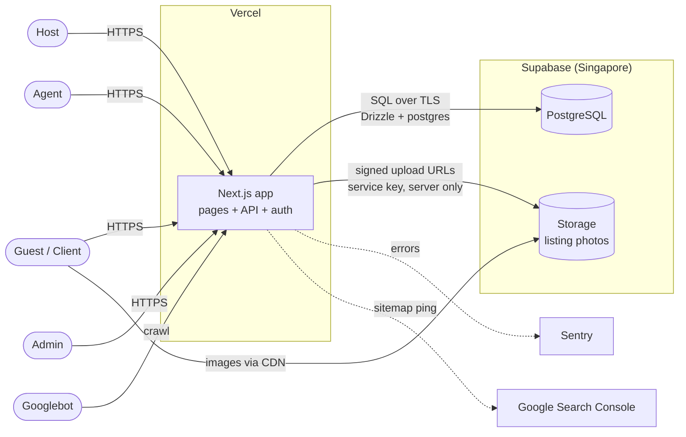
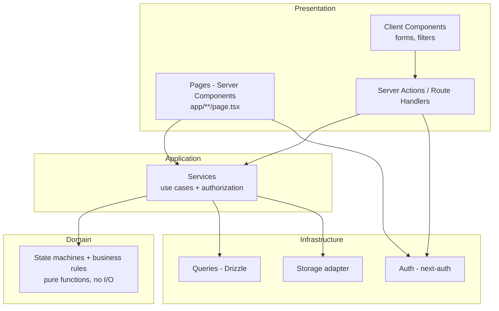
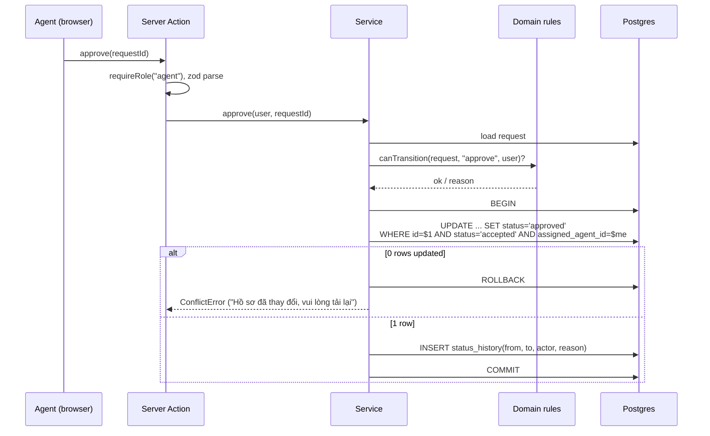
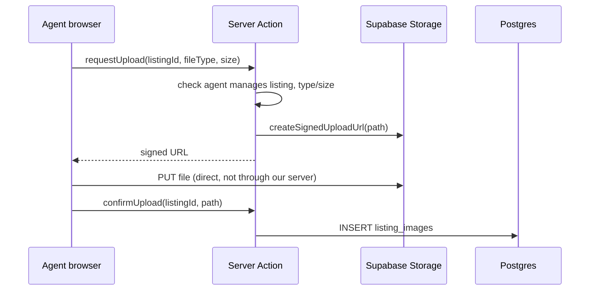
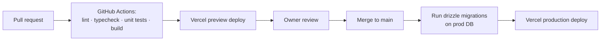

# RentHub — System Architecture

> Status: **Draft for review** by the project owner.
> Inputs: [`spec.md`](spec.md) (what to build), [`database.md`](database.md) (data model).
> Delivery plan: [`roadmap.md`](roadmap.md).

## 1. Goals and quality attributes

| Attribute | Target | How |
|---|---|---|
| **SEO** | Public listings indexed by Google, rich results eligible | Server-rendered public pages, clean Vietnamese URLs, metadata, JSON-LD, sitemap |
| **Performance** | Core Web Vitals "Good": LCP < 2.5s, INP < 200ms, CLS < 0.1 on 4G mobile | Server Components, ISR caching, optimized images, minimal client JS |
| **Security** | No cross-user data access, no invalid status transitions | Authorization in services, server-set ownership/status, RLS-locked DB, validated input |
| **Correctness** | Spec rules enforced even under concurrency | Conditional updates, DB constraints, transactions |
| **Maintainability** | A new developer can add a feature by following one pattern | Layered modules, one place per concern, tests per service |
| **Operability** | Errors are visible, deploys are reversible | Error tracking, structured logs, preview deploys, versioned migrations |
| **Cost** | Free/low tier at MVP traffic | Vercel Hobby/Pro + Supabase Free/Pro |

Out of scope (per spec): payments, e-contracts, live chat, advanced maps, multi-city.

## 2. System context



One deployable unit (a Next.js monolith). No separate backend service: at MVP scale a modular monolith is cheaper, simpler to deploy and easier to keep consistent. Module boundaries (section 4) keep the option to split later.

## 3. Deployment architecture

| Component | Choice | Region | Why |
|---|---|---|---|
| Web app | **Vercel** | `sin1` (Singapore) | Native Next.js host: ISR, image optimization, edge CDN, preview deploy per PR |
| Database | **Supabase Postgres** | `ap-southeast-1` (Singapore) | Same region as app → ~2 ms DB latency; managed backups |
| File storage | **Supabase Storage** | Same project | Public CDN for listing photos; signed uploads |
| DNS / domain | Domain registrar → Vercel | — | HTTPS auto-managed |
| Errors | Sentry (free tier) | — | Stack traces with release + user role |
| Search indexing | Google Search Console | — | Sitemap submission, coverage, Core Web Vitals report |

> Alternative if Google Cloud is required: Cloud Run (container, `asia-southeast1`) + Cloud CDN. Same code; loses Vercel's zero-config ISR and preview deploys. Recommendation: Vercel.

### Environments

| Env | App | Database | Purpose |
|---|---|---|---|
| Local | `npm run dev` | Supabase project **renthub-dev** | Development |
| Preview | Vercel preview per PR | renthub-dev (or a Supabase branch) | Review before merge |
| Production | Vercel production (`main`) | Supabase project **renthub-prod** | Real users |

Production and development **never share a database**. Secrets live in Vercel/Supabase dashboards and local `.env`; never in git.

### Database connection

- Server → Supabase **transaction pooler** (port 6543) with `prepare: false`, because serverless functions open many short connections.
- Migrations run through the **session pooler / direct** connection (port 5432).
- One shared client in `src/db/client.ts`, created once per server instance.

## 4. Application architecture

### Layers



Rules:

1. **Pages and actions are thin.** They read the session, validate input with zod, call one service, and render or redirect.
2. **Services own every business decision**: who may do what, which transition is valid, what happens in which transaction. A service receives the acting user as an argument; it never trusts IDs/status/owner from input.
3. **Domain is pure.** Transition tables and checks (e.g. `canTransition(request, action, actor)`) are plain functions, unit-tested without a DB.
4. **Only the infrastructure layer imports Drizzle or Supabase.**
5. Read-only public pages may call query functions directly (no service) when no authorization is involved.

### Folder structure

```
src/
  app/
    (public)/               # SEO pages: home, search, listing detail, ward pages
    (auth)/                 # login, register
    host/                   # Host dashboard (requests)
    agent/                  # Agent dashboard (queue, requests, listings, enquiries)
    account/                # Client: saved listings, my enquiries
    admin/                  # Admin: create agent accounts
    api/auth/[...nextauth]/ # next-auth
    sitemap.ts, robots.ts
  domain/                   # pure rules: property-request.ts, listing.ts, enquiry.ts
  services/                 # use cases: property-request.service.ts, listing.service.ts, ...
  db/
    schema.ts               # matches docs/database.md
    client.ts               # postgres + drizzle instance
    queries/                # read queries reused by pages
  lib/
    auth.ts                 # next-auth config, getCurrentUser(), requireRole()
    storage.ts              # Supabase Storage adapter
    errors.ts               # AppError types → HTTP / UI messages
    seo.ts                  # metadata + JSON-LD builders
    slug.ts                 # Vietnamese slug helper
  validators/               # zod schemas per form/action
  components/               # shared UI (ui/ primitives, listing/, forms/)
tests/
  unit/                     # domain + services
  e2e/                      # Playwright: the MVP acceptance flow
drizzle/                    # versioned SQL migrations (committed)
```

### Mutations: Server Actions first

Forms use **Server Actions** (no hand-written REST API for the app's own UI). Route Handlers (`app/api/...`) only where something external needs an HTTP endpoint (next-auth, future mobile app, webhooks).

Every action follows the same shape:

```ts
"use server";
export async function requestChangesAction(input: unknown) {
  const user = await requireRole("agent");            // 1. who
  const data = requestChangesSchema.parse(input);     // 2. what (zod)
  await propertyRequestService.requestChanges(user, data); // 3. do (rules + DB)
  revalidatePath(`/agent/requests/${data.requestId}`); // 4. refresh views
}
```

### Status transitions (one pattern for all three entities)



The domain check gives a friendly error; the conditional `WHERE` makes it safe under concurrency (two Agents, double clicks, stale tabs).

## 5. Security architecture

| Concern | Control |
|---|---|
| Authentication | next-auth Credentials provider, bcrypt (cost 12), JWT session in an HttpOnly, Secure, SameSite=Lax cookie, 7-day expiry |
| Authorization | `requireRole()` at the entry point + ownership/assignment checks inside services. Middleware only redirects unauthenticated users; it is **not** the security boundary |
| Self-registration | Only `host`/`client` accepted by the register schema; `agent` created by `admin` only |
| Mass assignment | zod schemas list allowed fields; `hostId`, `assignedAgentId`, `status`, `role` never accepted from input |
| Data API exposure | RLS enabled on all tables with no policies; Supabase anon key not used by the app |
| Storage | Listing photos in a public bucket (they are public anyway); uploads only through server-issued signed URLs; size/type checks (JPEG/PNG/WebP, ≤ 5 MB) |
| Abuse | Rate limiting on login, register, enquiry submission (per IP + per user) |
| Headers | CSP, HSTS, X-Content-Type-Options, Referrer-Policy, frame-ancestors none — set in `next.config.mjs` |
| Secrets | Only in env vars; `SUPABASE_SERVICE_ROLE_KEY` server-only (never `NEXT_PUBLIC_`) |
| Privacy | Host address line and internal notes never leave authorized views; public pages read only `listings` |
| Audit | `property_request_status_history` records every request transition |

## 6. SEO architecture

Goal: every published listing and every ward page can rank on Google for searches like *"cho thuê căn hộ quận 7"*, *"thuê nhà phường Tân Phong"*.

### 6.1 Rendering strategy

| Page | Rendering | Revalidation |
|---|---|---|
| Home `/` | Static + ISR | On publish/archive (`revalidatePath`) + every 1 h |
| Search `/thue-nha-quan-7` | Server-rendered per request (filters in query string) | — |
| Ward page `/thue-nha-quan-7/[ward]` | ISR | On publish/archive |
| Listing detail `/nha-cho-thue/[slug]` | ISR, `generateStaticParams` for published listings | On edit/publish/archive |
| Dashboards, login, account | Dynamic, `noindex` | — |

Googlebot always receives full HTML (no client-only rendering for public content).

### 6.2 URL design (Vietnamese, stable, readable)

| Page | URL |
|---|---|
| Listing | `/nha-cho-thue/can-ho-2-phong-ngu-phu-my-hung-a1b2c3` (slug + 6-char id suffix) |
| All District 7 | `/thue-nha-quan-7` |
| Ward | `/thue-nha-quan-7/phuong-tan-phong` |
| Type in ward (optional) | `/thue-nha-quan-7/phuong-tan-phong/can-ho` |

- If a title changes, the slug changes and the old URL **301-redirects** (resolved by the id suffix).
- Filter combinations beyond ward/type (price, bedrooms) use query strings and carry `canonical` to the clean page + `noindex,follow`, preventing thousands of thin duplicate pages.

### 6.3 Metadata

Built by `lib/seo.ts` and used by `generateMetadata` on each page:

- `<html lang="vi">`, unique `<title>` ≤ 60 chars (e.g. *"Căn hộ 2PN Phú Mỹ Hưng – 15 triệu/tháng | RentHub"*), meta description ≤ 155 chars.
- `alternates.canonical` on every page.
- Open Graph + Twitter card with the cover photo (for Zalo/Facebook sharing).
- `robots: noindex` on dashboards, auth, account, filtered search.

### 6.4 Structured data (JSON-LD)

| Page | Schema.org types |
|---|---|
| Listing | `RealEstateListing` with `Offer` (price, `VND`, `priceSpecification` per month), `Accommodation` (floorSize, numberOfRooms), `PostalAddress` (ward, District 7, HCMC — no house number), `image` |
| Ward / search | `ItemList` of listings + `BreadcrumbList` |
| All pages | `Organization` + `WebSite` |

Validated with Google's Rich Results Test before launch.

### 6.5 Lifecycle of a listing URL

| Listing status | HTTP response | In sitemap |
|---|---|---|
| `published` | 200, indexable | Yes, with `lastModified = updated_at` |
| `archived` | **410 Gone** page with links to similar listings | No |
| `draft` / unknown | 404 | No |

### 6.6 Crawl and discovery

- `app/sitemap.ts`: home, district page, every ward page with listings, every published listing.
- `app/robots.ts`: allow public routes; disallow `/host`, `/agent`, `/admin`, `/account`, `/api`; link to the sitemap.
- Internal linking: breadcrumbs, "similar listings in this ward", ward links in the footer.
- Submit sitemap in Google Search Console; monitor Coverage and Core Web Vitals.

### 6.7 Performance (Core Web Vitals)

- Server Components by default; client JS only for forms, filters, gallery.
- `next/image` with explicit sizes; cover image `priority`; WebP/AVIF; Supabase CDN as origin.
- `next/font` for self-hosted fonts with Vietnamese subset.
- No layout shift: fixed aspect-ratio image boxes, skeletons for client widgets.
- Target bundle: < 100 KB JS on listing detail.

### 6.8 Content guidelines (for Agents)

Title formula: *[Type] [bedrooms]PN [area/landmark] – [price]*; description ≥ 300 characters, unique (no copy-paste between listings); at least 5 photos recommended, first photo is the best one. These go into the Agent UI as hints.

## 7. Data and file flows

### Photo upload



Large files never pass through Vercel functions (body size limits, cost).

### Cache invalidation

Any service call that changes public data (publish, archive, edit published listing) calls `revalidatePath` for: the listing page, its ward page, the district page, home, and the sitemap.

## 8. Error handling and observability

- `lib/errors.ts` defines `NotFoundError`, `ForbiddenError`, `ConflictError`, `ValidationError`. Services throw them; actions map them to Vietnamese messages in the UI. Unknown errors show a generic message and are reported.
- Sentry for server and client errors, tagged with release and user role (no personal data).
- Structured `console` logs (JSON) for key business events: request submitted, claimed, approved, listing published, enquiry created. Viewable in Vercel logs.
- Uptime check on `/` and `/api/health` (DB ping).
- Supabase daily backups (Pro plan adds point-in-time recovery — recommended before launch).

## 9. Quality: testing and CI/CD

| Level | Tool | Covers |
|---|---|---|
| Unit | Vitest | Domain transition tables, slug, SEO builders, validators |
| Service / integration | Vitest + dev database (separate schema) | Authorization, conditional updates, concurrency (two claims at once), history writes |
| End-to-end | Playwright | The spec's acceptance flow (spec §6) + "cannot see other user's data" checks |
| SEO | Lighthouse CI + Rich Results Test | Performance, metadata, JSON-LD on listing page |



### Database migrations

- `db:push` is for local experimentation only.
- From the first deploy: `drizzle-kit generate` creates SQL files in `drizzle/` (committed, reviewed in the PR), and `drizzle-kit migrate` applies them to production. Never edit an applied migration.

## 10. Scalability path (not needed for MVP)

| When | Change |
|---|---|
| Search gets slow (> ~10k listings) | Postgres full-text search with `unaccent` + GIN index; later a search service |
| Expanding beyond District 7 | Add `district`/`city` columns + routes `/thue-nha-[district]` |
| Heavy read traffic | Already CDN/ISR cached; add read replica in Supabase |
| Notifications needed | Email via Resend on status changes (queue with Supabase cron / Vercel cron) |
| Mobile app | Expose existing services through Route Handlers |

## 11. Decisions log

| # | Decision | Alternatives considered | Reason |
|---|---|---|---|
| D1 | Modular monolith on Next.js | Separate API (NestJS/Express) | One deploy, shared types, enough for MVP |
| D2 | Vercel hosting | Google Cloud Run, VPS | Best Next.js support (ISR, images, previews) |
| D3 | Supabase as Postgres + Storage only | Supabase Auth | Keeps next-auth already chosen; simpler role handling |
| D4 | Server Actions for app mutations | REST API for everything | Less code, type-safe, built-in CSRF protection |
| D5 | Agent of a listing derived from its request | Store `agent_id` on listing | Single source of truth |
| D6 | Vietnamese slugs with id suffix | Pure UUID URLs | SEO + stable redirects |
| D7 | 410 for archived listings | 404 / keep page | Tells Google to drop it quickly |

## 12. Changes this document required in `database.md`

✅ Approved and applied to `database.md` and `schema.ts`: `wards` table (new wards), `listings.slug`, `users.is_active`. Kept below for history.


- `listings.slug` — `varchar(200) not null unique`, generated from title + id suffix (SEO URLs).
- `listings.ward_slug` — or a `wards` lookup table with `name` + `slug`, so ward pages have stable URLs and correct Vietnamese names. **Recommended: `wards` table**, and `property_requests.ward` / `listings.ward` become `ward_id` foreign keys.
- **Administrative reform:** since 1 July 2025 Vietnam removed the district level; the former District 7 area is now the new wards (Tân Thuận, Phú Thuận, Tân Mỹ, Tân Hưng — to be verified against the official list). Proposal: the `wards` table stores the **new** official wards for addresses, with an optional `former_name` for old ward names; URLs and titles keep "Quận 7" because that is still what people search for. **Needs owner confirmation.**
- `users.is_active` — needed if Admin must be able to disable Agent accounts.
