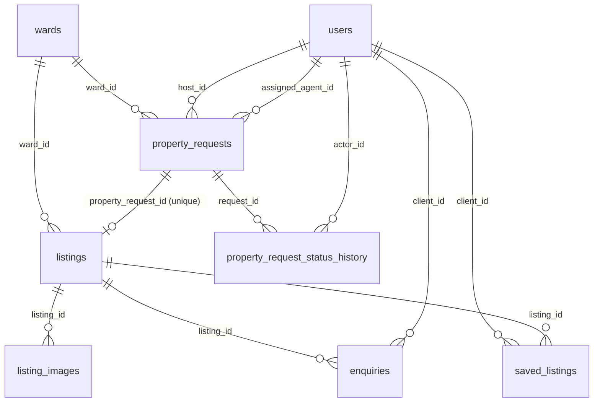

# RentHub — Database Design

> Based on [`spec.md`](spec.md). PostgreSQL on Supabase, schema defined with Drizzle in `src/db/schema.ts`.
> This document is the design; `schema.ts` must match it. Change this document first, then the code.

## Overview

| Table | Purpose |
|---|---|
| `users` | All accounts (host, agent, client, admin) |
| `wards` | Lookup of the new (post-2025) wards covering former District 7 |
| `property_requests` | Submissions from Hosts for Agent review |
| `property_request_status_history` | Every status change of a request: who, when, why |
| `listings` | Public posts created by Agents from approved requests |
| `listing_images` | Photos of a listing |
| `enquiries` | Contact requests from Clients on published listings |
| `saved_listings` | Listings a Client has saved |

## Conventions

- Primary keys: `uuid` with `gen_random_uuid()` default.
- Timestamps: `timestamptz`, `created_at` / `updated_at` default `now()`. `updated_at` is set by the app on every update.
- Money: `bigint`, whole **VND**, monthly rent. No decimals. CHECK `monthly_price > 0`.
- Column names `snake_case` in the DB, `camelCase` in Drizzle.
- Foreign keys use `ON DELETE RESTRICT` unless noted. Users and requests are never hard-deleted in the MVP.

## Enums

| Enum | Values |
|---|---|
| `user_role` | `host`, `agent`, `client`, `admin` |
| `property_type` | `apartment`, `house`, `townhouse`, `villa`, `studio`, `room` |
| `property_request_status` | `pending`, `accepted`, `needs_changes`, `approved`, `rejected`, `cancelled` |
| `listing_status` | `draft`, `published`, `archived` |
| `enquiry_status` | `new`, `contacted`, `closed` |

## Tables

### `users`

| Column | Type | Notes |
|---|---|---|
| `id` | uuid PK | |
| `name` | varchar(100) not null | |
| `email` | varchar(254) not null, **unique** | Stored lowercase |
| `phone` | varchar(20) | |
| `password_hash` | text not null | bcrypt |
| `role` | `user_role` not null | Self-registration only allows `host` or `client` |
| `is_active` | boolean not null, default true | Admin can disable an account; disabled users cannot log in |
| `created_at`, `updated_at` | timestamptz not null | |

### `wards`

Since 1 July 2025 Vietnam has no district level. Addresses use the **new** wards; URLs and page titles still say "Quận 7" because that is what people search for.

| Column | Type | Notes |
|---|---|---|
| `id` | smallint PK (identity) | |
| `name` | varchar(80) not null, **unique** | Official name, e.g. `Tân Hưng` |
| `slug` | varchar(80) not null, **unique** | URL part, e.g. `tan-hung` |
| `former_areas` | text | Old District 7 wards it covers (shown as a hint, helps search), e.g. `Tân Phong, Tân Quy, …` |
| `sort_order` | smallint not null, default 0 | Display order |

Seed data (inserted by a migration): **Tân Thuận, Phú Thuận, Tân Mỹ, Tân Hưng**. ⚠️ Verify names and `former_areas` against Resolution 1685/NQ-UBTVQH15 before launch.

### `property_requests`

| Column | Type | Notes |
|---|---|---|
| `id` | uuid PK | |
| `host_id` | uuid not null → `users.id` | Set by the server from the session |
| `assigned_agent_id` | uuid → `users.id` | Null while `pending`; set when an Agent claims it |
| `status` | `property_request_status` not null, default `pending` | Changed only through the transition service |
| `property_type` | `property_type` not null | |
| `title` | varchar(160) not null | |
| `description` | text | |
| `address_line` | varchar(255) not null | House number + street. **Private** (not copied to the listing automatically) |
| `ward_id` | smallint not null → `wards.id` | |
| `monthly_price` | bigint not null | Expected rent, VND |
| `area_sqm` | integer | |
| `bedrooms` | smallint | |
| `bathrooms` | smallint | |
| `host_notes` | text | Notes for the Agent; internal |
| `agent_notes` | text | Agent's internal notes; never public |
| `submitted_at` | timestamptz not null, default now() | Updated on resubmit |
| `created_at`, `updated_at` | timestamptz not null | |

Indexes: `(status)`, `(host_id)`, `(assigned_agent_id)`.

Scope is fixed to former District 7 (HCMC) for the MVP, so there is no `city` column; the ward implies the location.

The reason for "request changes" or "reject" is stored in the history table, not on this row. The UI shows the latest history entry's reason.

### `property_request_status_history`

| Column | Type | Notes |
|---|---|---|
| `id` | uuid PK | |
| `request_id` | uuid not null → `property_requests.id` | |
| `from_status` | `property_request_status` | Null for the initial `pending` entry |
| `to_status` | `property_request_status` not null | |
| `actor_id` | uuid not null → `users.id` | Who made the change |
| `reason` | text | **Required** when `to_status` is `needs_changes` or `rejected` (checked in the service + CHECK constraint) |
| `created_at` | timestamptz not null | |

Index: `(request_id, created_at)`.

Written in the **same transaction** as the status update on `property_requests`.

### `listings`

| Column | Type | Notes |
|---|---|---|
| `id` | uuid PK | |
| `property_request_id` | uuid not null, **unique** → `property_requests.id` | Enforces max one listing per request |
| `slug` | varchar(200) not null, **unique** | SEO URL: title slug + 6-char id suffix, e.g. `can-ho-2-phong-ngu-phu-my-hung-a1b2c3`. Regenerated when the title changes; old URLs redirect via the id suffix |
| `status` | `listing_status` not null, default `draft` | |
| `property_type` | `property_type` not null | Copied from the request, editable |
| `title` | varchar(160) not null | Public |
| `description` | text | Public |
| `monthly_price` | bigint not null | Public, VND |
| `area_sqm` | integer | |
| `bedrooms` | smallint | |
| `bathrooms` | smallint | |
| `ward_id` | smallint not null → `wards.id` | Public location |
| `street` | varchar(160) | Public location without house number |
| `published_at` | timestamptz | Set when first published |
| `created_at`, `updated_at` | timestamptz not null | |

Indexes: `(status, published_at desc)`, `(ward_id)`, `(monthly_price)`.

The managing Agent is **not stored** here: it is always `property_requests.assigned_agent_id` of the linked request. This avoids two places disagreeing about who owns the listing.

Publishing requires: `title`, `monthly_price`, `ward_id` filled, and at least one row in `listing_images`. Checked in the service.

### `listing_images`

| Column | Type | Notes |
|---|---|---|
| `id` | uuid PK | |
| `listing_id` | uuid not null → `listings.id`, **ON DELETE CASCADE** | |
| `storage_path` | text not null | Path in the Supabase Storage bucket |
| `sort_order` | smallint not null, default 0 | First image is the cover |
| `created_at` | timestamptz not null | |

Index: `(listing_id, sort_order)`.

### `enquiries`

| Column | Type | Notes |
|---|---|---|
| `id` | uuid PK | |
| `listing_id` | uuid not null → `listings.id` | Must be `published` when created |
| `client_id` | uuid not null → `users.id` | Set by the server from the session |
| `message` | text not null | |
| `contact_phone` | varchar(20) | Defaults to the client's phone |
| `status` | `enquiry_status` not null, default `new` | |
| `created_at`, `updated_at` | timestamptz not null | |

Indexes: `(listing_id, status)`, `(client_id)`.

The Agent handling an enquiry is found through `listing → property_request.assigned_agent_id`.

### `saved_listings`

| Column | Type | Notes |
|---|---|---|
| `client_id` | uuid not null → `users.id` | |
| `listing_id` | uuid not null → `listings.id`, ON DELETE CASCADE | |
| `created_at` | timestamptz not null | |

Primary key: `(client_id, listing_id)`.

## How the spec rules map to the database

| Spec rule | Enforced by |
|---|---|
| Host only sees own requests | Every query filters `host_id = session user` |
| Owner / agent / status not settable by users | Service never reads these from the request body; zod input schemas exclude them |
| Only one Agent can claim | `UPDATE property_requests SET status='accepted', assigned_agent_id=$me WHERE id=$id AND status='pending' AND assigned_agent_id IS NULL` — 0 rows updated = someone else won |
| Only the assigned Agent reviews | Update condition includes `assigned_agent_id = $me` |
| Valid transitions only | One transition map in `services/`; update condition includes the expected current status |
| Reason required for changes/reject | Service check + CHECK constraint on history |
| Status history | Insert into history in the same transaction |
| One listing per request | Unique `listings.property_request_id` |
| Listing only from approved request | Service checks request status inside the create transaction |
| Only published listings are public | Public queries filter `status = 'published'` |
| Internal notes not public | Notes live only on `property_requests`; public pages read only `listings` |

## Supabase notes

- The app connects to Postgres directly with the `postgres` driver (server side only). The browser never talks to the database.
- **Enable Row Level Security on every table with no policies.** Supabase exposes the `public` schema through its Data API using the public anon key; with RLS on and no policies, that API returns nothing, while our server connection (the `postgres` role) bypasses RLS and works normally.
- Sessions use next-auth JWT, so no sessions table is needed.

## Open questions

- Should listing status changes also be logged in a history table? The spec only requires it for property requests.
- Exact list of property types for District 7 — confirm the `property_type` values.
