# RentHub — Delivery Roadmap

> Status: **Draft for review**. Architecture: [`architecture.md`](architecture.md). Scope: [`spec.md`](spec.md).
> Each phase ends with something that runs and can be reviewed. Tick boxes as work lands.
> Every phase: `npm run lint`, `npm run build` and its tests pass before moving on.

## Overview

| Phase | Goal | Depends on | Size |
|---|---|---|---|
| 0 | Foundation: DB connected, migrations, CI, project skeleton | — | S |
| 1 | Accounts: register, login, roles, admin creates agents | 0 | M |
| 2 | Host: submit, edit, cancel property requests | 1 | M |
| 3 | Agent: queue, claim, request changes, approve, reject | 2 | M |
| 4 | Listings: create from approved request, photos, publish, archive | 3 | L |
| 5 | Public marketplace + SEO: home, search, ward pages, listing detail | 4 | L |
| 6 | Client: saved listings, enquiries; Agent handles enquiries | 5 | M |
| 7 | Hardening: E2E acceptance flow, security checks, performance | 6 | M |
| 8 | Launch: production env, domain, Search Console | 7 | S |

```mermaid
gantt
  dateFormat X
  axisFormat %s
  section Core
  0 Foundation      :p0, 0, 1
  1 Accounts        :p1, after p0, 2
  2 Host requests   :p2, after p1, 2
  3 Agent review    :p3, after p2, 2
  section Product
  4 Listings        :p4, after p3, 3
  5 Marketplace+SEO :p5, after p4, 3
  6 Enquiries       :p6, after p5, 2
  section Release
  7 Hardening       :p7, after p6, 2
  8 Launch          :p8, after p7, 1
```

(Units are relative effort, not calendar weeks.)

---

## Phase 0 — Foundation

- [x] Decide open items: `wards` table (new wards), `listings.slug`, `users.is_active` → `database.md` + `schema.ts` updated
- [x] Seed migration for `wards` (4 new wards; `former_areas` still to verify)
- [x] Supabase dev project (`oqbfajdloxnendyuwqhv`) + Supabase MCP
- [ ] `DATABASE_URL` in `.env` (owner pastes the connection string)
- [x] `src/db/client.ts` (postgres + drizzle, `prepare: false`)
- [x] Switch to versioned migrations: `db:generate` → `drizzle/`, `db:migrate`
- [x] Apply first migrations to dev DB; RLS enabled on all 8 tables, security advisor clean (only the expected "RLS without policy" info)
- [ ] Folder skeleton per `architecture.md` §4; `lib/errors.ts`
- [ ] Vitest set up with one passing test
- [ ] GitHub Actions: lint, typecheck, test, build
- [ ] Root layout: `lang="vi"`, base metadata, Vietnamese font subset

**Done when:** CI is green on a PR and the dev DB has all tables.

## Phase 1 — Accounts and access

- [ ] next-auth Credentials + JWT; role in token/session
- [ ] `getCurrentUser()`, `requireRole()`
- [ ] Register page (host or client only), login, logout
- [ ] Middleware redirects for `/host`, `/agent`, `/admin`, `/account`
- [ ] Admin page: create Agent account
- [ ] Seed script: one admin, two agents, one host, one client (dev only)
- [ ] Rate limit login and register
- [ ] Tests: cannot self-register as agent/admin; wrong role is blocked

**Done when:** each role logs in and lands on its own dashboard; others are blocked.

## Phase 2 — Host: property requests

- [ ] Domain: request transition table + `canTransition()` with unit tests
- [ ] Service: create, update (only `pending`/`needs_changes`), cancel (`pending`/`accepted`/`needs_changes`), resubmit
- [ ] History row written in the same transaction for every change
- [ ] Pages: my requests list, create form, detail with status + latest reason, edit, cancel
- [ ] Tests: host A cannot read/edit host B's request; edit blocked in wrong status

**Done when:** a Host can submit, edit and cancel, and history is recorded.

## Phase 3 — Agent: review workflow

- [ ] Queue page: `pending` requests
- [ ] Claim with conditional update; conflict message if already claimed
- [ ] My requests: request changes (reason required), approve, reject (reason required)
- [ ] Host resubmit → back to `accepted` with the same Agent
- [ ] Internal agent notes
- [ ] Tests: two agents claim at once → exactly one wins; non-assigned agent cannot review

**Done when:** spec flow "submit → request changes → resubmit → approve" works.

## Phase 4 — Listings

- [ ] Supabase Storage bucket + signed upload flow; type/size limits
- [ ] Create draft listing from `approved` request (prefill, no private address/notes)
- [ ] Edit listing; manage photos (order, cover, delete)
- [ ] Publish (required fields + ≥ 1 photo), archive, archived → draft
- [ ] Slug generation + uniqueness
- [ ] Tests: one listing per request; cannot publish without photo; only assigned agent manages

**Done when:** an Agent can publish a listing with photos.

## Phase 5 — Public marketplace and SEO

- [ ] Design system pass (use `/ui-ux-pro-max` for palette/typography; mobile first)
- [ ] Home page: hero search, latest listings, ward links
- [ ] Search `/thue-nha-quan-7` with filters (ward, type, price, bedrooms), pagination
- [ ] Ward pages `/thue-nha-quan-7/[ward]`
- [ ] Listing detail `/nha-cho-thue/[slug]`: gallery, facts, description, enquiry CTA, similar listings
- [ ] `generateMetadata`, canonical, Open Graph on every public page
- [ ] JSON-LD: `RealEstateListing`, `BreadcrumbList`, `ItemList`, `Organization`
- [ ] Archived → 410 page; old slug → 301
- [ ] `sitemap.ts`, `robots.ts`, `noindex` on private and filtered pages
- [ ] ISR + `revalidatePath` on publish/archive/edit
- [ ] Lighthouse ≥ 90 for Performance, SEO, Accessibility on listing detail (mobile)

**Done when:** a guest finds a published listing via search and Rich Results Test passes.

## Phase 6 — Clients and enquiries

- [ ] Save / unsave listing; saved list page
- [ ] Enquiry form (login required, rate-limited) on published listings only
- [ ] Client: my enquiries
- [ ] Agent: enquiries inbox for own listings; `new → contacted → closed`
- [ ] Tests: client sees only own enquiries; agent only enquiries on own listings

**Done when:** the full spec §6 flow works manually.

## Phase 7 — Hardening

- [ ] Playwright E2E: full spec §6 acceptance flow
- [ ] Playwright: cross-user access attempts and invalid transitions are blocked
- [ ] Security headers (CSP, HSTS, …); review env vars and bucket permissions
- [ ] Sentry wired (server + client); `/api/health`
- [ ] Empty states, error pages (404, 410, 500) in Vietnamese
- [ ] Accessibility pass (keyboard, labels, contrast)

**Done when:** all tests green; owner sign-off on a preview deploy.

## Phase 8 — Launch

- [ ] Supabase **prod** project (Singapore), backups; run migrations
- [ ] Vercel project, region `sin1`, env vars, custom domain + HTTPS
- [ ] Create real admin account; remove seed data
- [ ] Google Search Console: verify domain, submit sitemap
- [ ] Smoke test production flow
- [ ] Monitor first week: errors, Core Web Vitals, indexing coverage

**Done when:** RentHub is live and the sitemap is accepted by Google.

---

## Owner decisions

| # | Question | Decision |
|---|---|---|
| Q1 | Hosting | ✅ **Vercel** |
| Q2 | Ward model | ✅ **New post-2025 wards** (`wards` table); URLs/titles keep "Quận 7" |
| Q3 | Admin can disable accounts | ✅ **Yes** (`users.is_active`) |
| Q4 | Domain name | ⏳ Not bought yet. Use the free `*.vercel.app` URL for previews; **buy the domain before Phase 8** and only submit the real domain to Google (moving domains after indexing loses ranking time) |
| Q5 | Email notifications in MVP | ✅ **No** — users check status in their dashboards; revisit after launch |
